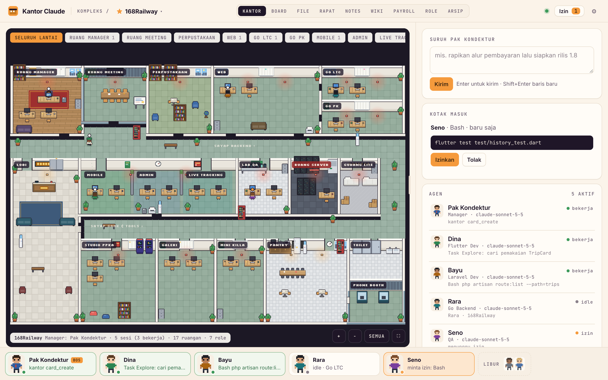
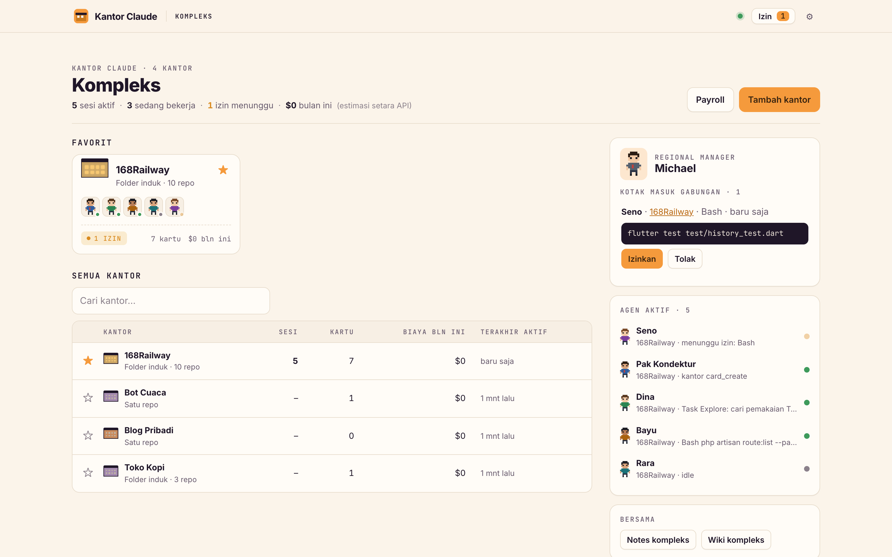
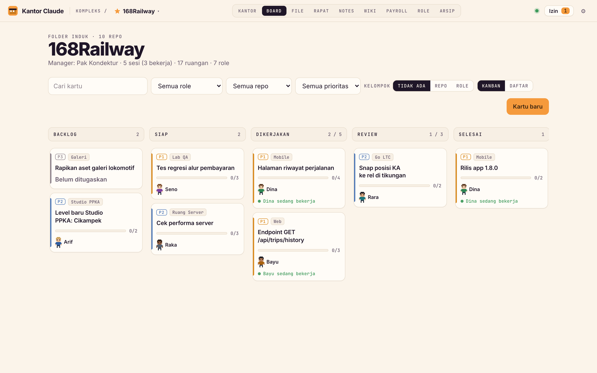
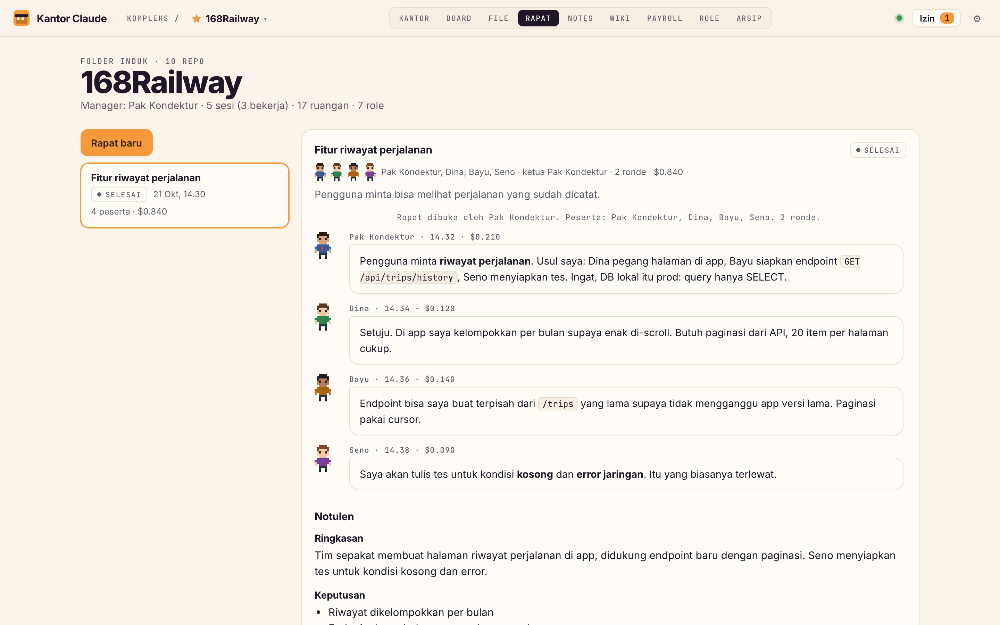
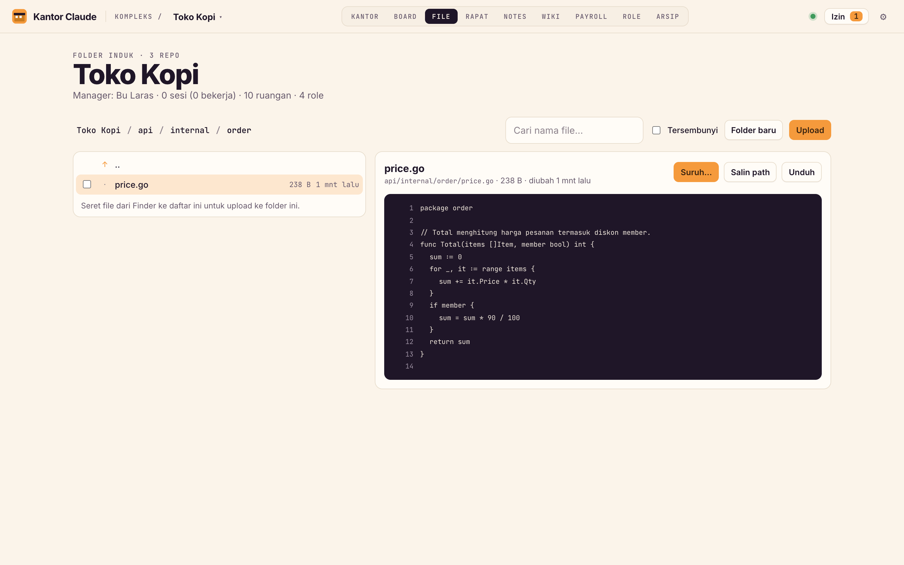
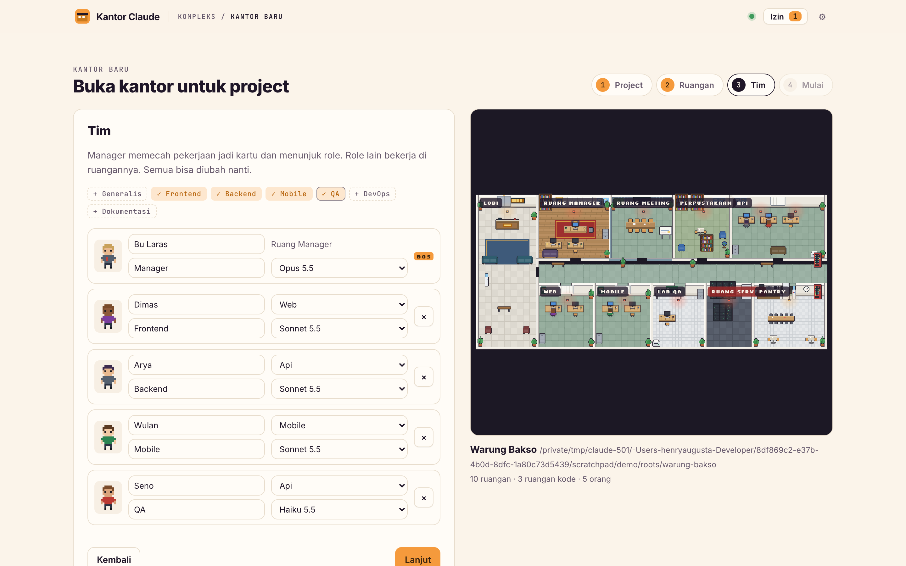
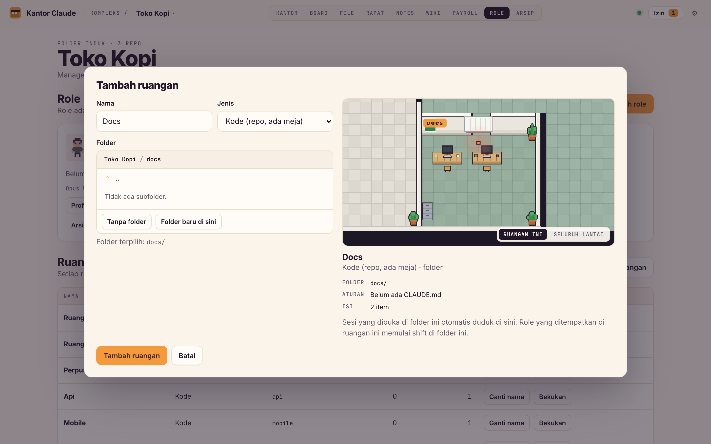
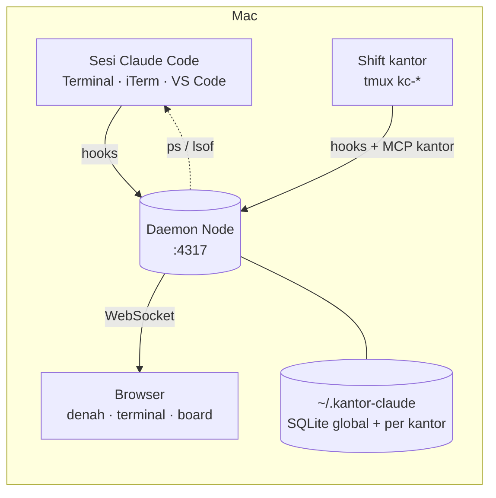

<div align="center">

# 🏢 Kantor Claude

**Kantor pixel-art untuk sesi Claude Code kamu.**
Setiap project jadi kantor, setiap repo jadi ruangan, setiap sesi Claude jadi orang yang duduk di mejanya.

*A pixel-art office for your Claude Code sessions: projects become offices, repos become rooms, and every Claude session is a coworker at a desk.*




</div>

---

## Kenapa?

Kalau kamu menjalankan banyak sesi Claude Code sekaligus (satu di `mobile/`, satu di `web/`, satu lagi sedang menunggu izin di tab VS Code yang tertutup), cepat sekali kehilangan jejak. Kantor Claude mengumpulkan semuanya di satu layar yang enak dilihat:

- **Siapa sedang mengerjakan apa**, dan di repo mana.
- **Siapa menunggu izin**: setujui atau tolak dari browser, tanpa mencari tab terminalnya.
- **Apa yang harus dikerjakan berikutnya**: board, rapat, wiki, dan notes yang dibaca juga oleh para agen.

Semua berjalan lokal di Mac kamu. Tidak ada server luar, tidak ada akun.

## Fitur

### 🗺️ Kompleks: semua kantor di satu halaman



- Kantor **favorit** disematkan paling atas, lengkap dengan wajah agen dan titik status (hijau bekerja, oranye minta izin).
- **Kotak masuk gabungan** dari semua kantor, dijaga oleh Michael, sang regional manager.
- **Agen aktif** lintas kantor: klik satu, kantornya terbuka dan sesinya langsung tampil.
- Sesi yang terminalnya **sudah ditutup** bisa dilanjutkan di kantor dengan ingatan yang sama.

### 🧑‍💼 Kantor: denah yang hidup

- Denah pixel tampak atas yang disusun otomatis dari struktur folder. Folder induk berisi banyak repo (seperti 168Railway) jadi kantor bersayap dengan lobi, koridor, pantry, ruang server, dan ruang rapat.
- Agen berjalan ke mejanya, menunjukkan apa yang sedang dikerjakan (`< mengedit history_page.dart`), dan **subagent** muncul sebagai karakter tersendiri.
- Panel kanan: suruh manager, kotak masuk izin, daftar agen. Klik agen untuk membuka **terminal sungguhan** (xterm.js + tmux) di browser.
- Terlihat juga sesi yang kamu buka sendiri di **Terminal.app, iTerm, atau VS Code**. Kantor mendeteksinya lewat hooks dan pemindai proses, dan bisa **memindahkan sesi itu ke kantor** tanpa kehilangan ingatannya.
- Mode izin tiap sesi (Auto, Edit otomatis, Plan, Bypass) bisa diganti dari kantor. Sama seperti menekan Shift+Tab di terminalnya.

### 📋 Board yang dipakai bersama agen



Lima kolom, prioritas, checklist, komentar, epic, riwayat. Agen membaca dan memperbarui kartu sendiri lewat tool MCP `kantor`: memindahkan kartu, mencentang checklist, menulis temuan.

### 🗣️ Rapat antar-role



Pilih peserta dan topik. Tiap role bicara bergiliran sesuai keahlian dan kepribadiannya, dan boleh membaca kode untuk mencari fakta. Kamu bisa menyela kapan saja. Hasilnya **notulen di wiki** dan **tindak lanjut** yang tinggal diklik jadi kartu. Kalau daemon restart di tengah rapat, rapat bisa dilanjutkan dari giliran terakhir.

### 📁 File manager: "taruh di file ini"



Jelajahi folder project, lihat kode, markdown, gambar, dan PDF, lalu upload dengan drag & drop. Centang file, klik **Suruh…**, dan tulis instruksinya ("taruh fungsi format rupiah di file ini"). Instruksi itu langsung diketik ke sesi yang sedang jalan, atau dijadikan kartu untuk role tertentu.

### ✨ Kantor baru dengan wizard



Project baru atau folder yang sudah ada. Kantor membuatkan foldernya (satu repo, atau folder induk berisi beberapa repo, plus `git init` dan `CLAUDE.md`), lalu kamu memilih tim dari preset. **Preview denah** ikut berubah di setiap langkah.

### 🚪 Tambah ruangan dengan preview



Pilih folder dengan menjelajah, lihat ruangan barunya di denah, dan ketahui sesi mana yang akan pindah ke sana sebelum disimpan.

### Dan lainnya

| | |
|---|---|
| 👥 **Role** | Nama, jabatan, kepribadian, skills, model, ruangan, **atasan**, dan buku catatan yang dibaca di awal shift berikutnya |
| 💸 **Payroll** | Estimasi biaya setara API per role dan per kantor, dihitung dari transcript |
| 📝 **Notes & Wiki** | Catatan bertag dengan sampah, dan wiki dengan revisi serta `[[tautan]]`. Agen bisa membaca dan menulis keduanya |
| 🗄️ **Arsip** | Semua sesi lama per kantor, bisa dilanjutkan sebagai role mana pun |
| ⭐ **Pindah kantor cepat** | Nama kantor di top bar jadi menu, favorit paling atas |

## Mulai

```bash
git clone https://github.com/manyunyu7/168railway_virtual_office.git kantor-claude
cd kantor-claude
npm install
node bin/kantor.js start      # daemon di http://127.0.0.1:4317
node bin/kantor.js open       # buka di browser (alamatnya berisi token)
```

Butuh **Node 22.13+**, **tmux** (`brew install tmux`), dan **Claude Code** (`claude`) di PATH.

Supaya semua sesi Claude terlihat, termasuk yang kamu buka sendiri:

```bash
node bin/kantor.js hooks install     # pasang hooks di ~/.claude/settings.json (cadangan otomatis)
node bin/kantor.js mcp install       # tool MCP `kantor` untuk semua sesi: board, wiki, notes, role
node bin/kantor.js service install   # jalankan daemon otomatis saat login (launchd)
```

| Perintah | Fungsi |
|---|---|
| `node bin/kantor.js status` | Cek daemon, hooks, dan layanan login |
| `node bin/kantor.js hooks uninstall` | Lepas hooks |
| `node bin/kantor.js mcp uninstall` | Lepas MCP `kantor` |
| `node bin/kantor.js service uninstall` | Matikan auto-start |
| `node bin/kantor.js shell-init` | Fungsi `kc` untuk menjalankan `claude` di dalam tmux |

## Cara kerja



- **Hooks** (`hooks/kantor-hook.cjs`) meneruskan event Claude Code ke daemon. Kalau daemon mati, hook langsung keluar tanpa mengganggu sesimu.
- **Shift** adalah sesi yang dimulai dari kantor. Ia berjalan di tmux (`kc-<kantor>-<role>`) dan membawa persona role, buku catatan, aturan kantor, dan MCP `kantor`. Bisa juga dibuka dari terminal biasa: `tmux attach -t kc-…`.
- **Pemindai proses** menemukan sesi yang belum pernah mengirim hook (lewat `ps` dan `lsof`), mengenali asalnya (VS Code, Terminal, iTerm), dan memulihkan shift yang id-nya berganti setelah `/clear`.
- **Izin**: permintaan izin masuk kotak masuk dan sekaligus tampil di terminal. Yang menjawab lebih dulu yang dipakai.
- **Data** disimpan di `~/.kantor-claude/kantor.db` (sesi, usage, kotak masuk) dan `~/.kantor-claude/offices/<id>.db` per kantor (role, board, notes, wiki, rapat). Tidak ada yang ditulis ke repo project, kecuali file yang kamu minta, seperti `CLAUDE.md` dari wizard atau upload dari file manager.
- **Rapat**: tiap giliran adalah satu `claude -p` dengan persona role dan tool hanya-baca.
- **Frontend** ditulis dengan ES module biasa, tanpa build step. Denahnya digambar di `<canvas>`.

## Keamanan

- Daemon hanya mendengarkan di `127.0.0.1`. IP Tailscale bisa ditambahkan lewat `extraHosts` di `~/.kantor-claude/config.json`.
- Semua akses butuh token, dan header `Host` dicek supaya situs lain tidak bisa memanggil daemon.
- **Terminal di browser sama dengan akses shell penuh.** Jangan buka port ini ke internet.
- File manager terkunci di dalam folder kantor (termasuk terhadap symlink). File mentah dikirim dengan CSP `sandbox`, sehingga file HTML atau SVG dari project tidak bisa menjalankan skrip di halaman kantor.
- Manager tidak bisa memberi role lain mode izin yang lebih longgar dari modenya sendiri.

## Pengembangan

```bash
npm run dev     # daemon dengan auto-restart
npm test        # tes server (node:test)
KANTOR_DEMO=1 KANTOR_HOME=/tmp/kantor-demo node server/index.js   # daemon showroom: tidak menyentuh sesi atau transcript asli
```

Kontrak antara server dan frontend ada di [`docs/FRONTEND-CONTRACT.md`](docs/FRONTEND-CONTRACT.md). Screenshot di README diambil dari daemon showroom yang berisi data contoh.

## Terima kasih

Terinspirasi dari [claude-office](https://github.com/paulrobello/claude-office) (paulrobello), pixel-agents, dan gaya visual Munder Difflin. Semua aset, karakter, dan kode di sini dibuat sendiri.
